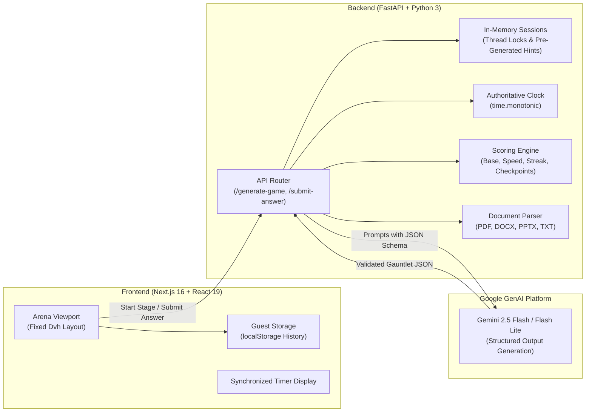

# ⚡ OmniQuest v0.9

> **The Server-Authoritative AI Knowledge Arena.**  
> Transform any topic or uploaded document into an adaptive, multi-tier knowledge gauntlet powered by Google Gemini.

[](https://omniquest-ai.vercel.app)
[-00e5ff?style=for-the-badge)](https://github.com/YourUsername/OmniQuest)
[](https://fastapi.tiangolo.com)
[](https://nextjs.org)

**Play the Live Arena:** [https://omniquest-ai.vercel.app](https://omniquest-ai.vercel.app)

---

## 📖 Table of Contents

- [Overview](#-overview)
- [What's New in v0.9?](#-whats-new-in-v09-)
  - [1. Document-Based AI Generation & RAG](#1-document-based-ai-generation--rag)
  - [2. Dynamic Game Configuration](#2-dynamic-game-configuration)
  - [3. Server-Authoritative Timing & Anti-Tamper Engine](#3-server-authoritative-timing--anti-tamper-engine)
  - [4. Difficulty-Based Power-Up System](#4-difficulty-based-power-up-system)
  - [5. Advanced Scoring & Tier Checkpoints](#5-advanced-scoring--tier-checkpoints)
  - [6. Fixed-Viewport Cyberpunk UI & Guest Experience](#6-fixed-viewport-cyberpunk-ui--guest-experience)
- [Evolution: v0.5 vs. v0.9](#-evolution-v05-vs-v09)
- [Gameplay Architecture](#-gameplay-architecture)
  - [The Gauntlet Loop](#the-gauntlet-loop)
  - [Escalating Difficulty Tiers](#escalating-difficulty-tiers)
- [Technical Architecture](#-technical-architecture)
- [API Reference](#-api-reference)
- [Local Development Setup](#-local-development-setup)
- [Project Directory Structure](#-project-directory-structure)
- [Known Limitations (v0.9 Beta)](#-known-limitations-v09-beta)
- [Roadmap](#-roadmap)
- [Contributing & Acknowledgements](#-contributing--acknowledgements)

---

## 🎮 Overview

**OmniQuest** bridges the gap between educational content consumption and competitive arena gaming. Instead of passive flashcards or static multiple-choice quizzes, OmniQuest leverages Google's Gemini models to generate high-fidelity, adaptive learning gauntlets with increasing cognitive depth.

Players enter the arena as a **Guest Challenger**, select any concept, subject, or upload personal study material, and battle through up to 20 escalating stages. Survival requires fast recall, tactical power-up usage, and accumulating enough **Insight Points (IP)** to cross strict intermediate checkpoint gates.

```
┌────────────────────────────────────────────────────────────────────────┐
│  SETUP ARENA            COMBAT STAGES               POST-GAME RECAP    │
│  ───────────            ─────────────               ───────────────    │
│  • Topic / Document ──► • 20s Monotonic Clock   ──► • Final IP Bank    │
│  • 4 Difficulties       • Speed & Streak Bonuses    • Accuracy Rating  │
│  • 5–20 Lengths         • Tactical Power-Ups        • Trophy Records   │
│  • Strict/Enhanced      • Checkpoint Clearance      • Level Progress   │
└────────────────────────────────────────────────────────────────────────┘
```

---

## ⭐ What's New in v0.9?

OmniQuest v0.9 represents a massive architectural leap from earlier prototypes, evolving from a simple prompt wrapper into an enterprise-grade, server-authoritative gaming engine.

### 1. Document-Based AI Generation & RAG
Transform your own lecture slides, research papers, and study guides into interactive challenge ladders:
- **Broad File Support:** Secure, sandboxed text extraction from **PDF** (`.pdf`), Word Documents (**DOCX**), PowerPoint Slides (**PPTX**), and Plain Text (**TXT**).
- **Flexible Ingestion Pathways:**
  - **Topic-Only:** AI dynamically synthesizes questions around your prompt.
  - **Document-Only:** The engine analyzes uploaded material, automatically infers the central subject, and builds tailored rounds.
  - **Combined (Topic + Document):** Semantic validation verifies that the topic is genuinely grounded in the document before generation begins.
- **Dual Generation Modes:**
  - **Strict Material Only:** Questions and explanations are 100% constrained to facts present in the uploaded document. If the document is insufficient or ambiguous, the engine fails gracefully rather than hallucinating distractors.
  - **AI Enhanced:** The document provides the core syllabus, while Gemini enriches questions with real-world scenarios, advanced edge cases, and cross-disciplinary reasoning.
- **Security & Prompt Injection Defenses:** Uploaded text passes deterministic normalization, character sanitization, and structured JSON schema enforcement, neutralizing attempts to override game parameters via document contents.

### 2. Dynamic Game Configuration
Gauntlets are no longer locked to a single rigid structure:
- **Custom Gauntlet Lengths:** Choose between **5 Questions** (Tier 1), **10 Questions** (Tiers 1–2), **15 Questions** (Tiers 1–3), or a full **20 Questions** marathon (All 4 Tiers).
- **Four Official Difficulties:** Tailor cognitive intensity with **Easy**, **Medium**, **Hard**, and **Expert** game runs.
- **Dynamic Checkpoint Slicing:** Intermediate checkpoint gates automatically adapt based on total stages selected.

### 3. Server-Authoritative Timing & Anti-Tamper Engine
In v0.9, client-provided timers are completely untrusted. The backend enforces mathematical fairness:
- **Server Monotonic Clock:** Question start times are recorded server-side with `time.monotonic()` when `/start-stage` is invoked.
- **20-Second Active Countdown:** Each question has exactly 20.0 seconds of gameplay. Submissions past the deadline (+ 1.0s network grace buffer) are rejected with `HTTP 400`.
- **Zero Drift Handshake:** The Next.js frontend begins the visual countdown instantly upon mounting while synchronizing with the authoritative server deadline.
- **1.0-Second Network Grace Buffer Policy:** In-flight network packets arriving between 20.0s and 21.0s are accepted to protect against connection hiccups, but **strictly receive 0 Speed Bonus**. Client-forged timing headers cannot manipulate IP.
- **Manual Stage Progression:** When an answer is submitted, active time immediately halts. Players can read AI explanations indefinitely without burning time off the next stage. Stage $N+1$ begins strictly when the player clicks **Next Stage**.
- **Forfeit Protection:** Players can voluntarily end a run via `POST /forfeit-game`, locking the session and preserving their banked Insight Points for post-game stats.

### 4. Difficulty-Based Power-Up System
Power-ups are allocated based on run difficulty, providing meaningful strategic choice:

| Difficulty | AI Hint | 50 / 50 | Time Freeze | Tactical Playstyle |
|---|:---:|:---:|:---:|---|
| **Easy** | 2 | 2 | 2 | Casual exploration with full tactical assistance |
| **Medium** | 1 | 1 | 2 | Balanced gauntlet requiring selective power-up timing |
| **Hard** | 0 | 0 | 2 | High stakes; only Time Freeze defense available |
| **Expert** | 0 | 0 | 0 | Pure unassisted mastery; zero room for error |

- **Sub-10ms AI Hints:** Hints are pre-generated during initial gauntlet creation and stored privately on the server. Activating a hint is instant ($< 10\text{ms}$) with zero runtime Gemini delay.
- **Deterministic 50/50:** Eliminates exactly two incorrect distractors; cached per stage to prevent duplicate calls from fishing for different answers.
- **Authoritative Time Freeze:** Freezes the countdown and extends the authoritative deadline by **exactly 5.0 seconds**. Enforces per-stage single-use limits, prevents concurrent double-activation, and never carries over unused time.

### 5. Advanced Scoring & Tier Checkpoints
OmniQuest rewards both accuracy and speed through a dual-currency scoring engine:
- **Base IP:** **100 IP** awarded for every correct answer.
- **Speed Bonus:** **5 IP per second remaining** on the clock, rounded half-up to mirror JavaScript `Math.round(remainingMs / 1000) * 5`, capped at **100 IP**.
- **Streak Fire Multiplier:** Answering 3 or more questions consecutively ignites Streak Fire, awarding a **+50 IP bonus** on every subsequent correct answer until broken.
- **Tier-Local Checkpoint Thresholds:** To pass an intermediate checkpoint gate (Stages 5, 10, 15), players must meet difficulty-dependent minimums earned *exclusively within that tier*:

| Difficulty | Stage 5 Gate | Stage 10 Gate | Stage 15 Gate | Clearance Rule |
|---|:---:|:---:|:---:|---|
| **Easy** | *No requirement* | *No requirement* | **300 IP** | Automatic advance in Tiers 1 & 2 |
| **Medium** | **150 IP** | **250 IP** | **300 IP** | Requires ~1–2 correct answers + speed |
| **Hard** | **300 IP** | **350 IP** | **400 IP** | Requires 3+ correct answers + speed |
| **Expert** | **300 IP** | **400 IP** | **500 IP** | Near-flawless accuracy required |

> **Note on Tier Meters:** Tier-local IP resets to `0` at each tier transition, while **Total IP** accumulates continuously throughout the entire run.

### 6. Fixed-Viewport Cyberpunk UI & Guest Experience
- **Zero Page Scrolling:** The arena uses a fixed viewport (`h-dvh max-h-dvh overflow-hidden`) with permanently anchored top HUD and bottom power-up controls. Only the central question card scrolls if text is long.
- **Guest Player Mode:** No forced account creation or authentication barriers. Player statistics, game history, and level progression are safely stored in browser `localStorage`.
- **Trophy Room & Match History:** Review previous runs, accuracy percentages, highest streaks, and earned Insight Points directly from the client.

---

## 🔄 Evolution: v0.5 vs. v0.9

| Capability | OmniQuest v0.5 | OmniQuest v0.9 (Pre-Release / Beta) |
|---|---|---|
| **Source Material** | Text topic prompt only | PDF, DOCX, PPTX, TXT uploads + Topic inputs |
| **Generation Modes** | Single generic prompt | **Strict Material Only** vs. **AI Enhanced** |
| **Topic Detection** | Manual entry required | **Automatic Topic Identification** from documents |
| **Gauntlet Length** | Fixed 20 questions | **Dynamic 5, 10, 15, or 20 questions** |
| **Difficulty Scaling** | Basic difficulty setting | **Easy, Medium, Hard, Expert** with progression matrices |
| **Question Timing** | Client-side `setTimeout` | **Server-authoritative monotonic clock** (`time.monotonic()`) |
| **Late Submissions** | Client reported remaining time | **Authoritative deadline enforcement**; $> 21\text{s}$ rejected |
| **Time Freeze** | Client-only timer pause | **Server-tracked 5.0s extension** with quota locks |
| **AI Hint Delivery** | 2-second runtime Gemini call | **Instant pre-generated hints** ($< 10\text{ms}$) |
| **Checkpoint Gates** | Hardcoded 300 IP for all tiers | **Difficulty-scaled threshold matrix** (150–500 IP) |
| **Scoring Integrity** | Client calculated speed bonus | **Backend calculated & verified** Base, Speed & Streak IP |
| **User Persistence** | Demo mock profile ("Alex Quinn") | **Pure Guest Mode** with local history & Trophy Room |

---

## 🕹 Gameplay Architecture

### The Gauntlet Loop

```mermaid
flowchart TD
    A["Arena Setup<br/>(Topic / Document)"] --> B["Select Mode & Length<br/>(5, 10, 15, or 20 Stages)"]
    B --> C["Gemini Gauntlet Generation<br/>(Bounded Randomness & Pre-Generated Hints)"]
    C --> D["Player Starts Stage<br/>(POST /start-stage)"]
    
    subgraph ActiveQuestionRound ["Active Question Round"]
        D --> E["20s Countdown Begins"]
        E -. Optional .-> F["Activate Power-Up<br/>(Hint / 50-50 / Freeze)"]
        F -. +5.0s .-> E
        E --> G["Submit Option<br/>(POST /submit-answer)"]
    end
    
    G --> H{"Server Validation"}
    H -- "Elapsed > 21.0s" --> H1["HTTP 400: Deadline Expired"]
    H -- "Valid Time" --> I["Calculate Base (100) + Speed (0-100) + Streak (+50)"]
    
    I --> J["Explanation Screen<br/>(Timer Paused Indefinitely)"]
    J --> K{"Is Stage a Checkpoint?<br/>(Stage 5, 10, or 15)"}
    
    K -- Yes --> L{"Tier Local IP >= Threshold?"}
    L -- No --> M["Elimination Game Over<br/>(Banked IP Saved)"]
    L -- Yes --> N["Tier Checkpoint Cleared!<br/>(Tier Meter Resets to 0)"]
    
    K -- No --> O{"Final Gauntlet Stage?"}
    N --> O
    O -- No --> P["Player Clicks Next Stage"] --> D
    O -- Yes --> Q["Victory Screen & Trophy Room"]
```

### Escalating Difficulty Tiers

Each tier groups 5 sequential questions engineered for escalating cognitive load:

| Tier | Stages | Focus | Distractor Profile |
|---|:---:|---|---|
| **Tier 1** | 1–5 | **Foundations & Core Recall** | Obvious distractors, direct definitions, basic concepts |
| **Tier 2** | 6–10 | **Conceptual Dynamics & Cause-Effect** | Subtle distractors, relational mechanics, operational flow |
| **Tier 3** | 11–15 | **Applied Scenarios & Edge Cases** | Technical problem-solving, plausible distractor traps |
| **Tier 4** | 16–20 | **Synthesis & Cross-Domain Evaluation** | Complex scenario analysis, multi-step deduction, Master Challenge |

---

## 🏗 Technical Architecture

OmniQuest implements a clear separation of concerns between client presentation, session management, and generative AI orchestration:



### Stack Components

| Layer | Technologies | Role |
|---|---|---|
| **Frontend Framework** | Next.js 16 (App Router), React 19 | Server-side rendering, responsive game shell |
| **Styling & Icons** | Tailwind CSS 4, Lucide React, TW Animate | Dark-neon aesthetic, fixed viewport architecture |
| **Backend API** | FastAPI, Uvicorn, Python 3.11+ | Server-authoritative routing, session state |
| **AI Integration** | `google-genai` SDK, Google Gemini 2.5 | Dynamic question generation, topic inference |
| **Document Ingestion**| `pypdf`, `python-docx`, `python-pptx` | Deterministic file extraction & sanitization |
| **Validation & Safety**| Pydantic v2 | Strict JSON schema parsing and bounded randomness |
| **Deployment** | Vercel (Frontend), Render (Backend) | Production hosting and continuous deployment |

---

## 🔌 API Reference

All requests and responses use standard `application/json` payloads (except document upload, which uses `multipart/form-data`).

| Method | Endpoint | Description | Request Body Summary |
|---|---|---|---|
| `POST` | `/upload-document` | Parses and sanitizes uploaded PDF/DOCX/PPTX/TXT files | `multipart/form-data` (`file`) |
| `POST` | `/generate-game` | Creates an in-memory gauntlet session from topic/material | `{ topic?, source_text?, question_count, difficulty, generation_mode }` |
| `POST` | `/start-stage` | Records authoritative monotonic start time for a stage | `{ session_id, stage_number }` |
| `POST` | `/submit-answer` | Validates answer against server deadline, calculates IP | `{ session_id, stage_number, selected_option }` |
| `POST` | `/use-hint` | Retrieves instant pre-generated AI hint under quota | `{ session_id, stage_number }` |
| `POST` | `/use-50-50` | Eliminates two incorrect options with server caching | `{ session_id, stage_number }` |
| `POST` | `/use-freeze` | Extends question deadline by 5.0 seconds (alias: `/use-time-freeze`) | `{ session_id, stage_number }` |
| `POST` | `/forfeit-game` | Voluntarily ends run while preserving banked IP | `{ session_id }` |

---

## 🚀 Local Development Setup

Follow these instructions to run the full OmniQuest development stack locally.

### Prerequisites
- **Node.js:** v18.18+ or v20+
- **pnpm** (recommended) or **npm**
- **Python:** v3.11+ (Python 3.12 or 3.13 recommended)
- **Google Gemini API Key:** Obtainable free from [Google AI Studio](https://aistudio.google.com/)

### 1. Clone the Repository
```bash
git clone https://github.com/YourUsername/OmniQuest.git
cd OmniQuest
```

### 2. Configure the Backend

```bash
cd backend

# Create virtual environment
python -m venv .venv

# Activate virtual environment
# Windows (PowerShell):
.\.venv\Scripts\Activate.ps1
# macOS / Linux:
source .venv/bin/activate

# Install dependencies
pip install -r requirements.txt

# Set your Gemini API Key
# Windows (PowerShell):
$env:GEMINI_API_KEY="your_actual_gemini_api_key_here"
# macOS / Linux:
export GEMINI_API_KEY="your_actual_gemini_api_key_here"

# Optional: Restrict allowed origins (defaults to http://localhost:3000)
# export FRONTEND_ORIGIN="http://localhost:3000"

# Start the FastAPI server (runs on http://127.0.0.1:8000)
uvicorn main:app --reload --port 8000
```

### 3. Configure the Frontend

Open a new terminal session in the project root:

```bash
cd frontend

# Install frontend dependencies
npm install
# or: pnpm install

# Optional: configure backend URL in .env.local (defaults to http://127.0.0.1:8000)
echo "NEXT_PUBLIC_API_BASE_URL=http://127.0.0.1:8000" > .env.local

# Start the Next.js development server
npm run dev
# or: pnpm dev
```

Open **`http://localhost:3000`** in your browser to enter the arena.

---

## 📁 Project Directory Structure

```
OmniQuest/
├── README.md                          # Project documentation and guide
├── backend/                           # Python FastAPI service
│   ├── document_parser.py             # PDF, DOCX, PPTX, TXT extraction
│   ├── fallback_gauntlet.json         # Offline demo fallback dataset
│   ├── game_logic.py                  # Scoring formulas, thresholds, Pydantic models
│   ├── gemini_service.py              # Google GenAI prompts and schema validation
│   ├── main.py                        # FastAPI routes and session synchronization
│   ├── requirements.txt               # Backend Python dependencies
│   └── tests/                         # Pytest test suite (230 automated tests)
│       ├── test_ai_hint_overhaul.py   # Pre-generated hint verification
│       ├── test_document_parser.py    # Document format extraction tests
│       ├── test_powerups_and_streak.py# Power-up quota and streak tests
│       ├── test_server_timing.py      # Monotonic timing & grace buffer boundary tests
│       └── test_tier_progression.py   # Tier checkpoint threshold tests
│
└── frontend/                          # Next.js 16 web application
    ├── app/
    │   ├── globals.css                # Global styles and Tailwind directives
    │   ├── layout.tsx                 # Root layout, metadata and viewport settings
    │   └── page.tsx                   # Main entry point mounting the app
    ├── components/
    │   ├── omniquest/                 # Core arena components
    │   │   ├── answer-button.tsx      # Interactive MCQ option buttons
    │   │   ├── arena-top-bar.tsx      # Top HUD with score, timer, and streak meter
    │   │   ├── gameplay-arena.tsx     # Viewport controller and round manager
    │   │   ├── how-to-play-modal.tsx  # Game rules, scoring and checkpoint modal
    │   │   ├── omniquest-app.tsx      # Master controller and navigation hub
    │   │   ├── power-ups-bar.tsx      # Bottom anchored tactical power-up tray
    │   │   ├── question-round.tsx     # Active question card and explanation view
    │   │   ├── results-screen.tsx     # Post-game analytics and victory screen
    │   │   ├── settings-modal.tsx     # Audio, feedback, and session settings
    │   │   ├── setup-screen.tsx       # Gauntlet creator (topic/document/mode)
    │   │   └── stage-ladder.tsx       # Desktop and mobile tier ladders
    │   └── ui/                        # Reusable base UI primitives
    ├── lib/
    │   ├── api.ts                     # Typed fetch client for backend endpoints
    │   ├── game-storage.ts            # LocalStorage persistence for Guest Mode
    │   ├── quiz-data.ts               # Shared types, tier styles, constants
    │   └── utils.ts                   # Tailwind utility helpers
    ├── package.json                   # Frontend npm dependencies and scripts
    └── tsconfig.json                  # TypeScript configuration
```

---

## ⚠️ Known Limitations (v0.9 Beta)

As an active Pre-Release / Beta milestone, OmniQuest v0.9 operates with the following explicit engineering constraints:
1. **Text-Layer Document Extraction Only:** Uploaded PDFs, DOCX, and PPTX files must contain a digital text layer. Scanned documents or image-only PDFs requiring Optical Character Recognition (OCR) are not yet supported.
2. **In-Memory Session Store:** Active game sessions are held in backend memory. Restarting the backend server drops active sessions in progress.
3. **Guest Mode Storage:** Player statistics, level badges, and game history persist exclusively in the client's browser `localStorage`. No centralized server database or multi-device account sync exists in v0.9.
4. **No Global Leaderboard:** Player ranks reflect personal guest performance rather than global matchmaking.
5. **Cold-Start Delays on Free Hosting:** When deployed on Render's free tier, the backend web service spins down after inactivity, resulting in a 30–50 second wake-up latency on the initial game generation.

---

## 🗺 Roadmap

<details open>
<summary><b>Click to expand development roadmap</b></summary>
<br/>

### v0.9: Pre-Release / Beta *(Current Release)*
- [x] Document-based question generation (PDF, DOCX, PPTX, TXT).
- [x] Strict Material Only vs. AI Enhanced generation modes.
- [x] Automatic topic identification and relevance validation.
- [x] Dynamic gauntlet lengths (5, 10, 15, 20 questions).
- [x] Server-authoritative monotonic clock timing & deadline enforcement.
- [x] Sub-10ms pre-generated backend AI hints.
- [x] Difficulty-based power-up limits and tier progression matrices.
- [x] Client Guest Mode with persistent localStorage Trophy Room.

### v1.0: First Official Production Release *(Upcoming)*
- [ ] **Full OCR Engine:** Integration of Tesseract / Google Cloud Vision for scanned and image-based document uploads.
- [ ] **Persistent Database:** PostgreSQL / Supabase storage for game rounds, global player accounts, and permanent match replays.
- [ ] **Global & Topic Leaderboards:** Compare clear times and Insight Points against challengers worldwide.
- [ ] **Detailed Analytics Export:** Export comprehensive PDF/Markdown study reports summarizing missed concepts and key takeaways.

### v1.5: Multiplayer & Interactive Combat *(Future)*
- [ ] **Live PvP Duels:** Real-time head-to-head gauntlets over WebSockets with shared countdown clocks.
- [ ] **Interactive Mini-Games:** Sudden-death tiebreaker rounds, speed recall drills, and matching games.
- [ ] **Custom Classroom / Team Gauntlets:** Shareable gauntlet codes for educators and study groups.

</details>

---

## 🤝 Contributing & Acknowledgements

### Contributing
Contributions, bug reports, and suggestions are welcome!
1. Fork the repository.
2. Create your feature branch (`git checkout -b feature/amazing-feature`).
3. Commit your changes (`git commit -m 'feat: add amazing feature'`).
4. Ensure all backend tests pass (`pytest backend/tests`) and frontend compiles (`npm run build`).
5. Push to the branch (`git push origin feature/amazing-feature`).
6. Open a Pull Request.

### Acknowledgements
- **[Google Gemini](https://ai.google.dev/)** for high-throughput multimodal intelligence.
- **[FastAPI](https://fastapi.tiangolo.com/)** for asynchronous Python API performance.
- **[Next.js](https://nextjs.org/) & [Vercel](https://vercel.com/)** for the React application framework and hosting.
- **[Tailwind CSS](https://tailwindcss.com/) & [Lucide](https://lucide.dev/)** for UI styling and typography.

---

<p align="center">
  <b>Built for learners, gamers, and curious minds.</b><br/>
  <sub>OmniQuest v0.9 (Pre-Release / Beta)</sub>
</p>
